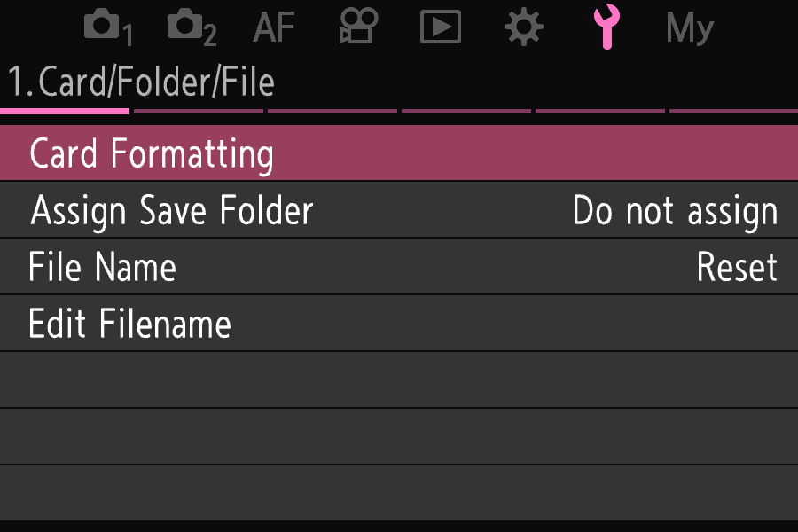

# OM-Emu

OM-Emu is a lab, written in JavaScript, that runs Olympus / OM System camera firmware outside the camera. It emulates
the MN10300 (AM33) CPU these bodies use and the devices the firmware's user interface depends on (interrupt
controller, timers, the OSD engine, the VSC display compositor, the SCPU interface), then runs the firmware's own
uITRON kernel, GUI and camera application natively. Where a part of the camera is not modelled, a named stand-in
takes its place (S-SCENE for the image sensor, S-CARD for the memory card, and so on), and the player's status lists
the ones in use. Its reference body is the OM-1 with firmware v1.9 (code E143); other bodies run through ports
that translate the lab's E143 addresses into their own builds.

It is not a full-system emulator. The firmware does not boot from reset: the lab runs the kernel's own
initialisation with a few boot steps stood in, then drives the start of the display, the GUI and the camera
application from a harness task of its own. The image sensor and the camera modules that run autofocus, the release
and movie recording are not modelled; stand-ins produce what the screens show. No firmware is included in this
repository: you download it from the vendor yourself (see "Quick start").



*The OM-3 (E147, firmware v1.1) in the player (`node emu/bin/play.mjs --model E147`) after one press of MENU: the
Setup menu's first page, drawn by the firmware's own GUI on the emulated TFT.*

## What works today

On the OM-1 (E143), in the interactive player in your browser: the power-on start to the shooting screen, the menus
and the Super Control Panel, S1 / S2 and REC with a synthetic scene on the live view, playback of the pictures taken,
the TFT and the EVF. Scripted menu sessions (`emu/bin/nav.mjs`) and a debug API (`emu/bin/debug.mjs`: registers,
memory, breakpoints, traces) drive the same machine without the page.

Other bodies, through ports (as of 2026-10-21):

| Body | Code | Status |
|---|---|---|
| OM-1 Mark II, OM-3 | E146, E147 | start, S1, S2, playback on the TFT and the EVF (`emu/bin/modelcheck.mjs` passes) |
| OM-5, E-M1 III, E-M1X, E-M5 III, E-P7, E-M10 IV, E-M1 II, E-M10 III | E144, E139, E134, E137, E142, E140, E125, E130 | shooting screen with its picture and S1 on the TFT; S2 and the EVF are open |
| TG-7 | E145 | the start ends in POWER_ON with a one-colour frame |
| E-PL9, TG-5 | E133, E129, E132 | the start runs part way, then every task waits |
| PEN-F | E122 | start, S1, S2, playback on the TFT and the built-in EVF with the card's file system native (`emu/bin/modelcheck.mjs` passes; the firmware formats and mounts the card, counts 1470 shots from it and writes S2's picture to it); the frames show the shooting screen the GUI draws, in its own palette; the count probe is an expected failure, as the application asks for the count only on events (2026-10-30) |
| E-M5 II, E-M10 II | E118, E120 | E-M5 II: the start runs natively to its camera application's shooting screen state on the TFT and the EVF (the GUI draws the clock warning into its OSD layers; the composite is still one colour, its display sync's form unread) and stops at about 5 s in the movie time, its card's file system not yet native; E-M10 II: the start runs the application and the GUI natively and stays at the power-on state on the TFT and the EVF (2026-10-30) |
| 14 older bodies (E-PL5, E-M1, E-M10, TG-4, E-PL8 and others) | E100-E126 | surveyed, not tried |

[docs/model-survey.md](docs/model-survey.md) has the evidence per body; [docs/ROADMAP.md](docs/ROADMAP.md) has the
plan.

## Quick start

You need node 26 or newer. There are no npm packages to install and no Python is needed.

```sh
node emu/bin/fetch-fw.mjs              # download the OM-1 firmware, verify it against BLOBS.sha256, unpack it
node emu/bin/fetch-fw.mjs --check      # verify what is on disk again, change nothing
emu/play.sh                            # the interactive player, opened in your default browser
emu/play.sh --model list               # the bodies, their firmware versions, whether each is on disk
emu/play.sh --model E146               # another body (its firmware is fetched on first use)
emu/play.sh --no-browser               # print the player's localhost URL instead of opening it
```

`fetch-fw.mjs` asks the vendor's public updater API for the `.BIN` (about 240 MB for the OM-1), stores it under `fw/`,
checks its digest, and unpacks the two blocks the lab reads into `unpacked/<code>/` with the JavaScript unpacker. The
API serves only each body's latest release, so a release newer than the one pinned in `BLOBS.sha256` is refused. With
the files in place, `sha256sum --ignore-missing -c BLOBS.sha256` checks them independently.

The player serves its page and API on `127.0.0.1` only. It can also run entirely in the browser, with the lab in a
Web Worker and no server of its own: serve `emu/` from any static server on localhost (for example
`python3 -m http.server -d emu 8000 --bind 127.0.0.1`), open `http://127.0.0.1:8000/web/index.html` and choose the
camera's `.BIN`. The page reads the file locally and keeps the unpacked blocks in the browser's private storage;
nothing is uploaded. [emu/README.md](emu/README.md) covers the player's options, the debug API, the scripted sessions
and the other tools.

## Tests

```sh
node emu/bin/test-pure.mjs             # or: npm --prefix emu run test:pure
```

This runs on any checkout: the ISA vectors, the CPU's two execution tiers in lockstep, the pure units, and the
firmware rules on every body that is unpacked. The full suite (`node emu/bin/test.mjs`, emu's regression reference
`node emu/bin/golden.mjs check`, the checks, `node emu/bin/modelcheck.mjs`) needs the firmware you fetched;
[emu/README.md](emu/README.md) "Tests" says what each command covers and what else it needs.

## Repository layout

| Path | What it holds |
|---|---|
| `emu/` | the emulator: `src/` (CPU, devices, machine, the lab, firmware tools), `bin/` (command-line tools), `host/` (node hosts), `web/` (the browser player), `checks/` (with its fixtures), `refs/`, `scenarios/`, `test/` (with the ISA vectors) and `golden.json` (the regression reference) |
| `docs/` | the firmware and hardware specs, the roadmap, the model survey and the firmware container format |
| `analysis/` | firmware-patch investigations: [the OM-1 to OM-1 Mark II feature gap](analysis/feature-gap/README.md), [lens-gated features](analysis/lens-gates/README.md), [ND128](analysis/nd128/README.md), [a study of fishcu/oly_fw_analysis](analysis/oly-fw-analysis/README.md) |
| `artifacts/nd128/` | the ND128 candidate's manifest (patch sites and digests; the image itself is built locally) |
| `tools/` | `olyfw.py` (a Python container unpacker), `om1_nd128.py` (builds the ND128 candidate), `mn10300dis.sh` (spot disassembly with a locally built `mn10300-objdump`), `omfw_download.sh` (the updater request with curl) |
| `BLOBS.md`, `BLOBS.sha256` | every large file the lab uses, where it comes from, how to make it, and its digest |

## Documentation

- [emu/README.md](emu/README.md): the user and developer guide (running, the debug API, the browser player, tests,
  performance).
- [emu/ARCHITECTURE.md](emu/ARCHITECTURE.md): how emu is built and what counts as ground truth;
  [emu/FIDELITY-NOTES.md](emu/FIDELITY-NOTES.md): where it departs from the hardware.
- [docs/README.md](docs/README.md): the index of the specs (CPU and ISA, kernel, cores, interrupts and timers, VSC,
  input, menus, settings, text, shutter, UDF), with the evidence tags and address notation they use.
- [docs/ROADMAP.md](docs/ROADMAP.md), [docs/hle-gaps.md](docs/hle-gaps.md),
  [docs/model-survey.md](docs/model-survey.md), [docs/firmware-container.md](docs/firmware-container.md).

## Status and disclaimer

This is a research project. Nothing in it is written to a camera, and it has not been tried on one. `analysis/` and
[docs/firmware-container.md](docs/firmware-container.md) describe patched firmware candidates and how firmware is
repacked and flashed; writing modified firmware to a camera can brick it, and these notes are research, not
instructions. The firmware belongs to its vendor: this repository holds no firmware image, no unpacked block and no
traces or frames from running it. It does hold what the reverse engineering derived: addresses, register and name
tables (`emu/checks/fixtures/om1-vsc-regs.h`), digests and short recorded observations that the tests compare
(`emu/checks/fixtures/`, `emu/golden.json`), and short disassembly and string excerpts (`analysis/`). Olympus and OM
System are trademarks of their owners; this project is not affiliated with them.
